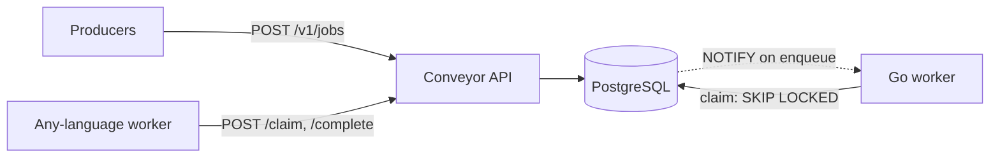
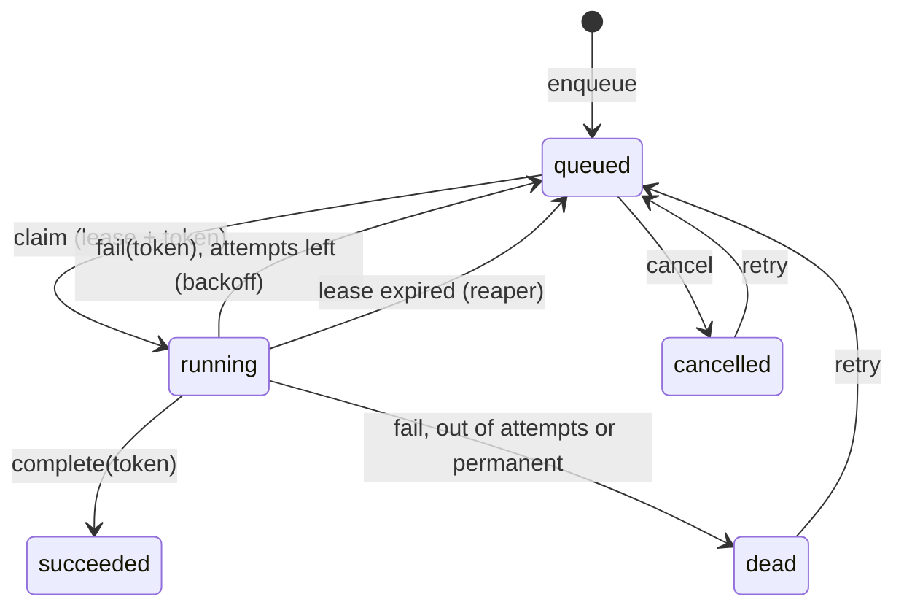

# Conveyor

**A durable, distributed job queue on PostgreSQL, written in Go.** If you already run Postgres, Conveyor gives you background jobs with retries, scheduling, idempotency and a dead-letter queue, with no Redis or broker to operate.

- **Exactly one worker per job:** claims use `SELECT … FOR UPDATE SKIP LOCKED`, so any number of workers share a queue without blocking or double-claiming.
- **Leases with fencing tokens:** a claimed job is leased for a fixed time. Completing or failing it requires the lease's random token, so a worker that stalled past its lease can't overwrite the result of the worker that took over.
- **Crash recovery:** a reaper returns jobs whose worker vanished to the queue.
- **Retries:** exponential backoff with full jitter, then a **dead-letter** state you can inspect and retry.
- **Idempotent enqueue** (`idempotency_key`), **priorities**, **scheduled jobs** (`run_at`), and cancellation.
- **Instant wake-ups:** workers `LISTEN` for new jobs instead of polling, with polling as a fallback.
- **Go library** (`queue`, `worker`) plus an **HTTP API** for producers and workers in any language, Prometheus metrics, and a small dashboard.



## Benchmarks

Measured with `conveyor bench` on a laptop (Windows 11, PostgreSQL 18 running locally, default settings), with all components on the same machine:

| Measurement | Result |
|---|---|
| Enqueue, 32 concurrent producers | ~2,000 jobs/s |
| Process, 8 workers × 8 concurrency, no-op handler | ~3,300 jobs/s |
| Wake latency, enqueue committed to handler start (idle workers) | p50 0.7 ms · p95 2.4 ms · p99 9.1 ms |

Each enqueue and claim is a durable Postgres transaction, so throughput is bounded by commit rate. Use batching or a dedicated broker if you need tens of thousands of jobs per second. Run it yourself with `conveyor bench -jobs 10000 -workers 8`.

## Job lifecycle



## Quick start

Requirements: Go 1.25+ and a PostgreSQL 14+ database.

```bash
cp .env.example .env            # set DATABASE_URL
export $(grep -v '^#' .env | xargs)
go run ./cmd/conveyor migrate
go run ./cmd/conveyor keys create -name me -scopes admin        # prints a key once; store it
go run ./cmd/conveyor serve                                     # http://127.0.0.1:8080
go run ./cmd/conveyor demo-worker -queue emails                 # in another terminal
```

Enqueue a job:

```bash
curl -X POST localhost:8080/v1/jobs \
  -H "Authorization: Bearer $CONVEYOR_KEY" -H "Content-Type: application/json" \
  -d '{"queue":"emails","kind":"email.send","payload":{"to":"ada@example.com"},"idempotency_key":"welcome-42"}'
```

Open http://127.0.0.1:8080 and paste an `admin` key to see queue depth and dead letters.

## Using the Go library

```go
store := queue.NewStore(pool)

// Producer
store.Enqueue(ctx, queue.EnqueueParams{
    Queue: "emails", Kind: "email.send",
    Payload: json.RawMessage(`{"to":"ada@example.com"}`),
    IdempotencyKey: "welcome-42",
})

// Worker
w := worker.New(store, worker.Config{Queue: "emails", Concurrency: 8})
w.Handle("email.send", func(ctx context.Context, job queue.ClaimedJob) error {
    var p struct{ To string `json:"to"` }
    if err := json.Unmarshal(job.Payload, &p); err != nil {
        return worker.Permanent(err) // bad input: don't retry
    }
    return send(ctx, p.To)          // any other error is retried with backoff
})
w.Run(ctx) // returns after ctx is cancelled and in-flight jobs finish
```

The worker renews leases while handlers run, recovers panics, applies a per-job timeout, cancels a handler whose lease was lost, and drains in-flight jobs on shutdown.

## HTTP API

All endpoints except `/` and `/healthz` need `Authorization: Bearer <key>`.

| Method and path | Scope | Purpose |
|---|---|---|
| `POST /v1/jobs` | enqueue | Enqueue (`201`, or `200` when the idempotency key already exists) |
| `GET /v1/jobs/{id}` | enqueue | Job status (never includes the lease token) |
| `POST /v1/queues/{queue}/claim` | work | Lease up to `limit` jobs for `lease_seconds` |
| `POST /v1/jobs/{id}/heartbeat` | work | Extend a lease |
| `POST /v1/jobs/{id}/complete` | work | Mark succeeded (`409` if the lease was lost) |
| `POST /v1/jobs/{id}/fail` | work | Record a failure; `"retryable": false` dead-letters it |
| `GET /v1/jobs?queue=&status=&before=` | admin | List jobs (keyset pagination) |
| `POST /v1/jobs/{id}/retry`, `/cancel` | admin | Retry a dead job; cancel a queued one |
| `GET /v1/stats`, `GET /metrics` | admin | Queue depth as JSON or Prometheus text |

## Security

| Area | What's done |
|---|---|
| API keys | 256-bit random, shown once; only the SHA-256 is stored; scoped (`enqueue`, `work`, `admin`); revocable; `last_used_at` tracked |
| Authorization | Producers can't claim or read other jobs in bulk; workers can't enqueue or administer; lease tokens are needed to finish a job and are never returned by status reads |
| Abuse limits | Per-key token-bucket rate limit; failed authentications rate-limited per client IP; 256 KiB payload cap; request body limit; strict JSON (unknown fields and trailing data rejected) |
| HTTP server | Read, write, header and idle timeouts; 16 KiB header cap; panics recovered to a generic `500`; internal errors never returned to clients; authorization headers never logged |
| Dashboard | Static files, `default-src 'none'` CSP with `script-src 'self'` only, `frame-ancestors 'none'`; all job data rendered with `textContent` (no HTML injection); the key lives only in that tab's `sessionStorage` |
| Data | Parameterized queries throughout; `CHECK` constraints on queue names, sizes and states; job payloads are stored as data, never executed |
| Container | Static binary on distroless `nonroot`: no shell, no package manager |
| Supply chain | `govulncheck`, `go test -race`, gitleaks and Dependabot in CI |

Deployment notes: `serve` binds to `127.0.0.1` by default. Run it behind a TLS-terminating proxy, and connect to Postgres with `sslmode=verify-full` in production. Rate limits are per process.

## Tests

```bash
go test ./...
```

Tests run against a real PostgreSQL. Locally an embedded Postgres starts automatically, with no Docker or setup. CI uses a Postgres service container and the race detector. They cover claim ordering, scheduling, idempotency, retries and dead letters, lease fencing against stale workers, crash recovery, 12 workers racing over 300 jobs with each processed exactly once, worker heartbeats, panics and graceful shutdown, and the HTTP API's authentication, scopes, validation and headers.

## Project layout

```
queue/          storage layer: enqueue, claim, complete, fail, heartbeat, reap, stats (+ SQL migrations)
worker/         worker pool: handlers, leases, heartbeats, LISTEN/NOTIFY, graceful shutdown
internal/api/   HTTP API, rate limiting, embedded dashboard
internal/auth/  hashed, scoped API keys
cmd/conveyor/   CLI: migrate, serve, keys, demo-worker, bench
```

## License

MIT
